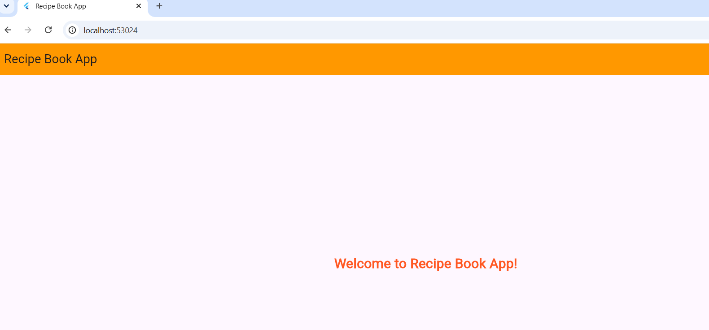
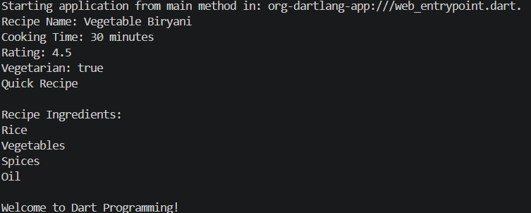
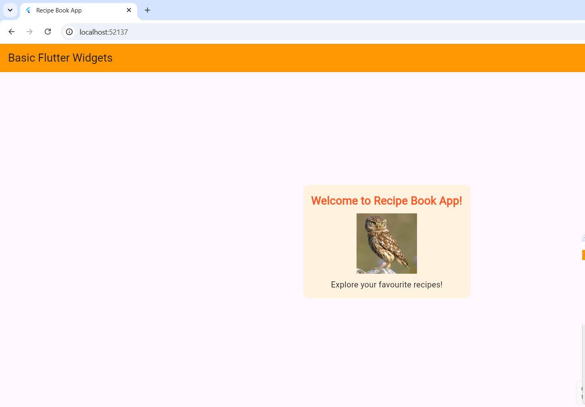
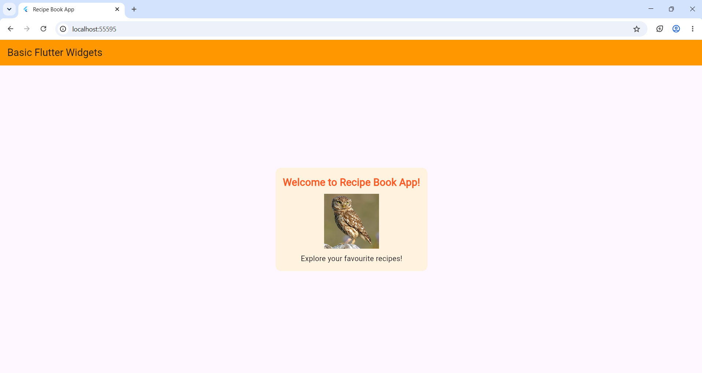
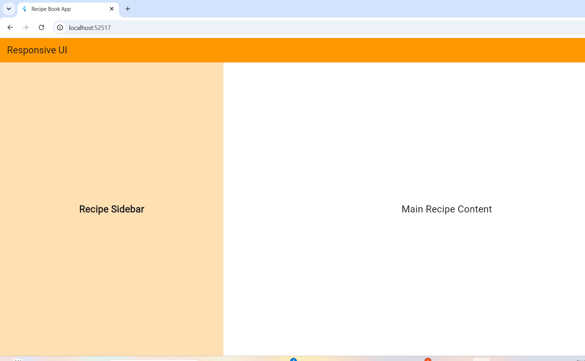

# Recipe Book App

## Abstract

The Recipe Book App is a Flutter-based mobile application developed to help users explore, organize, and manage their favourite recipes in a simple and convenient way. The application aims to provide an easy-to-use interface for displaying recipe-related information.

The project is developed step by step by implementing different Flutter and Dart concepts through experiments. It includes Flutter and Dart basics, widgets and layouts, images, icons, navigation, and responsive user interface design.

This project helps in understanding the practical implementation of Flutter concepts while developing a useful recipe management application. The Recipe Book App can be further improved by adding features such as recipe categories, ingredients, cooking instructions, search functionality, and favourite recipes.

---

## Experiment 1 – Flutter and Dart Basics

In this experiment, I created the basic Recipe Book App project and learned the fundamentals of Flutter and Dart programming.

### Experiment 1(a) – Installation of Flutter and Dart SDK

In this experiment, I installed and configured the Flutter and Dart SDK and set up the development environment.

### Experiment 1(a) Output

---

## Experiment 1(b) – Dart Language Basics

In this experiment, I practised basic Dart programming concepts such as variables, data types, operators, conditional statements, loops, and functions.

### Experiment 1(b) Output

---

## Experiment 2 – Exploration of Basic Flutter Widgets

### Experiment 2(a) – Basic Flutter Widgets

**Aim:** To explore core structural and presentational widgets in Flutter: Text, Image, Container, and Scaffold.

### Description

In this experiment, I explored the basic widgets available in Flutter by developing a simple user interface for the Recipe Book App.

The `Scaffold` widget was used to create the basic screen structure, while the `AppBar` widget was used to display the application title. The `Text` widget was used to display welcome messages, and the `Image` widget was used to display an image from the internet.

The `Container` widget was used to provide padding, margin, background colour, and rounded corners. The `Center` and `Column` widgets were used to arrange and align the content on the screen.

### Widgets Used

- **Scaffold:** Provides the basic screen structure.
- **AppBar:** Displays the application title.
- **Text:** Displays text content.
- **Image:** Displays an online image.
- **Container:** Provides styling and spacing.
- **Center:** Aligns content at the centre.
- **Column:** Arranges widgets vertically.

### Experiment 2(a) Output

The following screenshot shows the output of the Recipe Book App displaying the basic Flutter widgets.

---
## Experiment 2(b) – Layout Structures using Row, Column, and Stack

### Aim
To construct flexible layouts using Row, Column, and Stack widgets in Flutter.

### Description

In this experiment, I explored Flutter layout widgets by developing a simple user interface for the Recipe Book App.

The `Row` widget was used to arrange recipe action icons horizontally. The `Column` widget was used to arrange recipe details vertically, such as recipe name, cooking time, and rating.

The `Stack` widget was used to overlap multiple containers and text on top of each other. These widgets help create flexible and attractive user interfaces in Flutter.

### Widgets Used

- **Row:** Arranges child widgets horizontally.
- **Column:** Arranges child widgets vertically.
- **Stack:** Places widgets on top of one another.
- **Container:** Creates coloured boxes with specified dimensions.
- **Text:** Displays recipe information.
- **Icon:** Displays star, favorite, and like icons.
- **Scaffold:** Provides the basic screen structure of the application.

### Procedure

1. Open the Flutter project in VS Code.
2. Open the `lib/main.dart` file.
3. Implement the Row, Column, and Stack widgets.
4. Run the application using `flutter run`.
5. Observe the horizontal, vertical, and overlapping layouts.

### Experiment 2(b) Output

The following screenshot shows the output of the Recipe Book App demonstrating Row, Column, and Stack widgets.

### Result

Thus, flexible layouts using Row, Column, and Stack widgets were successfully implemented and displayed in the Recipe Book App.

## Experiment 3 – Responsive UI Design

### Experiment 3(a) – Responsive UI Design

### Aim
To build a responsive user interface that adapts dynamically to diverse viewport sizes.

### Description

In this experiment, I implemented responsive UI design in Flutter for the Recipe Book App. Responsive design allows an application to adjust its layout according to the available screen size.

The `LayoutBuilder` widget was used to inspect the available screen width and apply different layouts based on the width condition.

For wider screens, the `Row` widget was used to display the recipe sidebar and main content side by side. For smaller screens, the `Column` widget was used to arrange the recipe header and main content vertically.

The `Expanded` widget was used to distribute the available screen space between the layout sections.

### Widgets Used

- **LayoutBuilder:** Checks the available screen constraints.
- **Row:** Arranges widgets horizontally on wider screens.
- **Column:** Arranges widgets vertically on smaller screens.
- **Expanded:** Divides the available space among child widgets.
- **Container:** Provides background colours and layout sections.
- **Scaffold:** Provides the basic application structure.

### Procedure

1. Open the Flutter project in VS Code.
2. Open the `lib/main.dart` file.
3. Implement the `LayoutBuilder` widget to check screen width.
4. Use `Row` for wider screens and `Column` for smaller screens.
5. Run the application using `flutter run`.
6. Test the application by resizing the browser window or changing the device size.

### Experiment 3(a) Output

**Wide Screen Layout**

### Result

Thus, a responsive user interface was successfully developed in the Recipe Book App using Flutter's LayoutBuilder, Row, Column, and Expanded widgets. The application adapts dynamically to different screen dimensions.